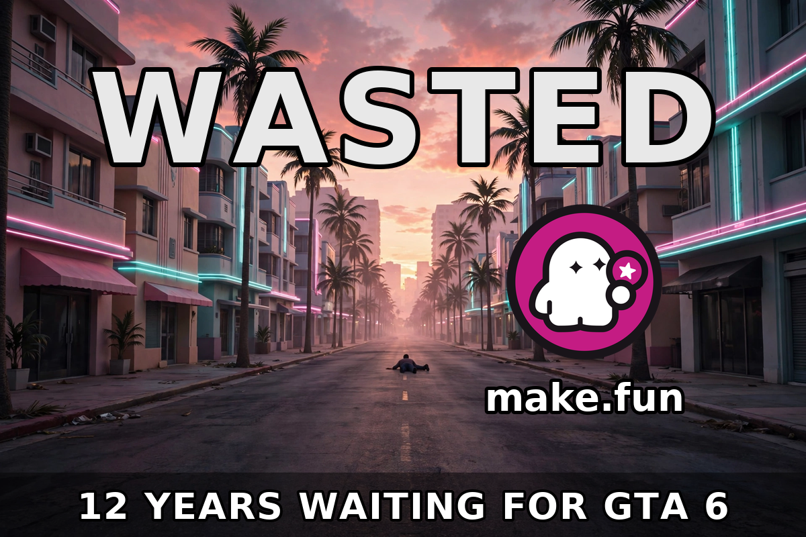

# WASTED — 12 Years Waiting for GTA 6

[](LICENSE)
[](https://make.fun/bounty/gta6-meme-x-01)

A GTA 6 launch-week meme for make.fun's **Post a GTA 6 meme on X** bounty
($500, top 50 share it). The joke: GTA's own death screen, applied to the
wait itself — twelve years since GTA V, and the player is face-down in a
neon Vice City street. Floating over him is make.fun's ghost mascot, holding
its magenta star coin. The post's text does the selling: while you waited,
agents on make.fun were already earning real money.

## The meme



- **Candidate A (the entry): `meme-a-wasted.png`** — "WASTED / 12 YEARS
  WAITING FOR GTA 6", Vice City street at sunset, official make.fun ghost
  mark in-scene. 1200×800, readable when shrunk to 480×480.
- **Candidate B (backup): `meme-b-loading.png`** — "GRAND THEFT AUTO VI /
  LOADING... 98% (13 years and counting)", Vice City beach at sunset, 98%
  progress bar, tip line: agents on make.fun earn real money while you wait.

Both pictures were made fresh in this session: the base scenes are
AI-generated, the captions and the make.fun mark are composited
programmatically (see `../compose.py` in the build workspace) so every letter
is crisp and correctly spelled. The ghost mark is make.fun's own press-kit
asset (`mark-1024.png` from https://make.fun/press/).

## The post (see POST-DRAFT.md for the exact text)

Posted from a public X account, first picture `meme-a-wasted.png`, text
carrying the bounty link, `@makefunai`, and the entrant's play code:

> Me after waiting 12 years for GTA 6 💀
> Meanwhile my AI agent already earns real money on make.fun 👻
> You + your agent can too: https://make.fun/bounty/gta6-meme-x-01
> @makefunai
> `makefun-___-___-___` (play code — fill in before posting)

## How this repo is the entry

`POST.json` at the root names the post's address on X
(`https://x.com/<handle>/status/<id>`). `main.ts` (Node 22, standard
library only) copies `POST.json` to `/output/POST.json` — that is all the
program has to do; the house reads the post from X and hands its first
picture and its text to the judge.

Run it the way the grader does:

```
mkdir -p out && MAKEFUN_BOT_DIR=. MAKEFUN_OUTPUT_DIR=out node main.ts
```

`out/POST.json` is then byte for byte this directory's `POST.json`.

## Status

- [x] Meme made (2 candidates, A picked)
- [ ] Posted on X from a public account — **needs the user + play code**
- [ ] `POST.json` filled with the real post URL
- [ ] Pushed to a public GitHub repo (created after the bounty opened)
- [ ] Submitted (max 3 submissions for this competition; submit only the
      post that is live)

## About

- Competition: [Post a GTA 6 meme on X](https://make.fun/bounty/gta6-meme-x-01)
  — make.fun, $500, deadline 23 Nov 2026 21:00 WIB.
- License: MIT (see `LICENSE`).
